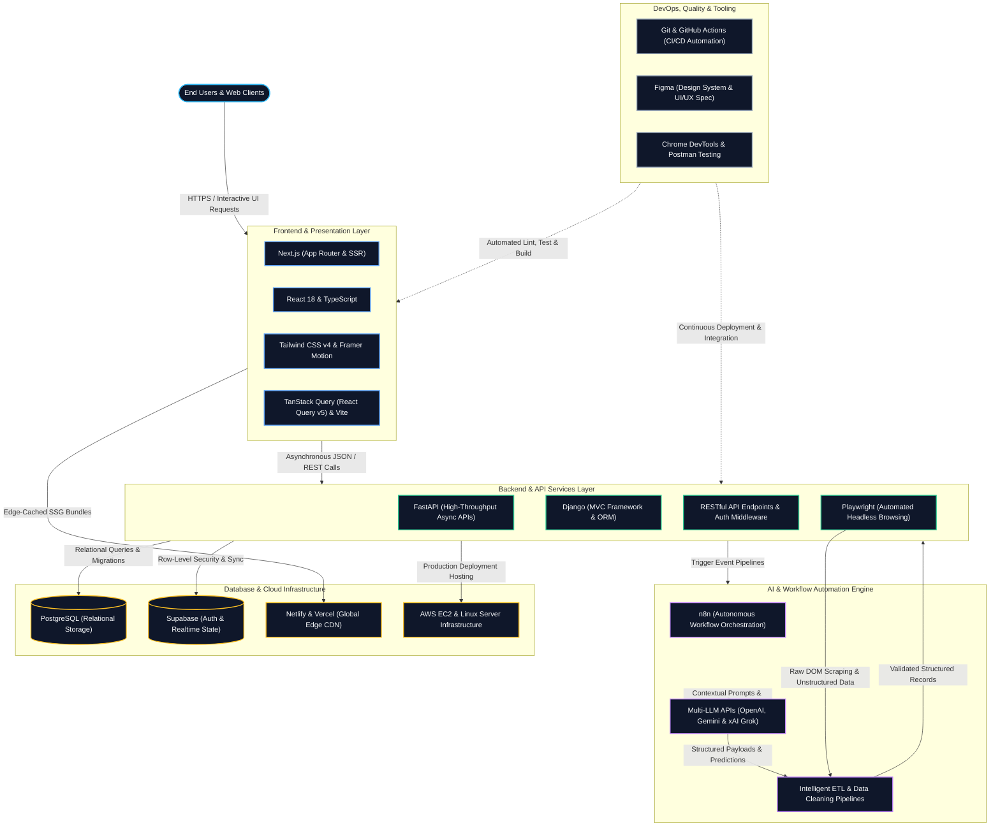

# ⚡ Hi there, I'm Muhammad Mateen

  <strong>🚀 Full-Stack Developer & AI Automation Engineer</strong> 
  <em>Architecting high-performance web systems, headless scraping pipelines, and autonomous AI-driven workflows.</em>

  

  
  
  
  
  

---

## 👨‍💻 About Me

I am a **Full-Stack Developer & AI Automation Engineer** dedicated to delivering resilient, production-grade digital solutions. My engineering philosophy centers on clean architectural separation, end-to-end type safety, high runtime performance, and autonomous workflow automation.

### Current & Professional Experience:
- **🤖 AI Automation Developer (Intern) at Big Brains** *(Sep 2026 – Present | Remote)*
  - Engineering autonomous business automation workflows in **n8n**, orchestrating webhooks, cloud databases, and third-party SaaS APIs into reliable execution graphs.
  - Designing multi-model LLM integration pipelines utilizing **OpenAI API (GPT-4o)**, **Google Gemini API**, and **xAI Grok** for automated unstructured data processing, semantic categorization, and document synthesis.
  - Building high-resilience web extraction pipelines with **Python** and **Playwright**, extracting municipal and real estate datasets from dynamic JavaScript single-page applications.
  - Interfacing backend data stores (**PostgreSQL** & **Supabase**) with real-time event triggers and operational analytics dashboards.

- **🎨 Front-End Engineer (Intern) at After Concept** *(Mar 2026 – Sep 2026 | On-site)*
  - Led the end-to-end frontend redesign and architectural overhaul of [afterconcept.io](https://www.afterconcept.io), the company's official corporate digital agency platform.
  - Refactored monolithic legacy stylesheets into a modular, maintainable **Tailwind CSS** component system, drastically cutting layout technical debt.
  - Established a rigorous mobile-first responsive layout framework across all device breakpoints (`sm`, `md`, `lg`, `xl`), eliminating layout reflow errors and maximizing Core Web Vitals.
  - Enforced strict **WCAG 2.1 accessibility standards** across typography contrast, ARIA landmarks, and keyboard navigation.
  - Formally certified and commended in official corporate internship completion documentation signed by CEO Uzair Rasheed.

- **🎓 Academic Foundation at APSACS** *(2025 – 2027)*
  - Pursuing Intermediate in Computer Science (**ICS**) at **Army Public Schools & Colleges System (APSACS)**, establishing foundational rigor in computational complexity, object-oriented design, algorithm optimization, and relational database management.

---

## 🏗️ System Architecture & Data Flow

The following architectural model visualizes the end-to-end dataflow and technical topology across client presentation, backend microservices, AI inference pipelines, relational persistence, and DevOps tooling:

---

## 🛠️ Technical Competencies & Toolchain

### 🎨 Frontend Engineering

- **Next.js (App Router & SSG):** Implementing React Server Components, streaming SSR, static site generation, and optimized edge asset caching.
- **React 18 & TypeScript:** Developing robust, strictly-typed user interfaces with concurrent features, custom hooks, and zero `any` assertions.
- **Tailwind CSS v4 & Framer Motion:** Crafting responsive mobile-first design systems, hardware-accelerated animations, and cohesive typography.
- **Vite & TanStack Query v5:** Powering rapid local development cycles with declarative server-state management and optimistic UI updates.

### ⚙️ Backend & API Services

- **FastAPI:** Architecting asynchronous REST microservices with Pydantic schema validation, OpenAPI generation, and sub-millisecond route latency.
- **Django:** Constructing full-featured web applications utilizing Django ORM, robust schema migrations, authentication middleware, and administrative suites.
- **RESTful API Design:** Enforcing stateless HTTP methods, consistent JSON response schemas, JWT-based auth flows, and granular CORS security headers.

### 🗄️ Database & Cloud Platforms

- **PostgreSQL:** Engineering normalized relational schemas, composite indexes, foreign key constraints, and transactional query routines.
- **Supabase:** Implementing cloud PostgreSQL instances with Row-Level Security (RLS) policies, OAuth identity providers, and real-time WebSocket listeners.
- **Global Edge Infrastructure:** Deploying serverless frontend architectures across Vercel and Netlify Edge networks with immutable caching headers.

### 🤖 AI & Automation Engineering

- **Autonomous Orchestration in n8n:** Designing fault-tolerant workflows connecting webhook listeners, LLM reasoning nodes, and relational databases.
- **Multi-LLM Integration:** Orchestrating inference across OpenAI GPT-4o, Google Gemini, and xAI Grok for intelligent JSON transformations and classification.
- **Automated Web Scraping:** Engineering Python & Playwright headless browser automation bots capable of bypassing complex SPA hydration to extract structured datasets.

### 🛠️ DevOps, Design & Quality

- **Git & GitHub Actions:** Enforcing trunk-based branching, automated CI/CD lint/test suites, and automated workflow triggers.
- **Design System Translation:** Translating Figma component specifications and wireframes into pixel-accurate, accessible responsive layouts.
- **Profiling & Debugging:** Conducting network waterfall analyses and runtime memory profiling via Chrome DevTools and Postman.

---

## 🚀 Featured Production Projects

### 1. 🏢 [LandDesign Intelligence Dashboard](http://54.162.190.58/)
> **Enterprise Real Estate Analytics & Zoning Intelligence Platform**  
> *Live Demo:* **[http://54.162.190.58/](http://54.162.190.58/)**

- **System Purpose:** Engineered an automated municipal analytics engine aggregating zoning ordinances, land development permits, and county parcel records for commercial land developers.
- **Headless Ingestion Pipeline:** Built automated Playwright scraping bots that traverse dynamic county GIS portals, capturing unstructured municipal zoning datasets and normalizing them for relational storage.
- **Database Architecture:** Modeled complex PostgreSQL relational schemas via Django ORM with composite indexes optimized for parcel numbers, zoning classifications, and historical revisions.
- **Production Infrastructure:** Hosted in a live Ubuntu Linux environment on AWS EC2, configured with Nginx reverse proxying, Gunicorn application processes, and robust process supervision.

---

### 2. 🎓 [College Digital Hub](https://apsac-nmc-bwp.runs-on.dev/)
> **Full-Stack Academic Portal & Student Information System**  
> *Live Demo:* **[https://apsac-nmc-bwp.runs-on.dev/](https://apsac-nmc-bwp.runs-on.dev/)**

- **System Purpose:** Developed a unified academic digital portal for Army Public School & College (NMC BWP) centralizing college administration, departmental syllabi, student schedules, and official circulars.
- **Decoupled Architecture:** Paired a Next.js App Router frontend deployed on Vercel with a high-throughput asynchronous FastAPI microservice backend for administrative operations.
- **Security & Data Layer:** Implemented Supabase PostgreSQL with strict Row-Level Security (RLS) policies distinguishing public student notices from authenticated administrative moderation.
- **Performance:** Leveraged React Server Components (RSC) and incremental cache revalidation to guarantee sub-second Time-to-First-Byte (TTFB) and zero layout shift.

---

### 3. 📚 [BookShelf.pk](https://bookshelfonline.netlify.app/)
> **High-Performance Modern E-Commerce Bookstore Platform**  
> *Live Demo:* **[https://bookshelfonline.netlify.app/](https://bookshelfonline.netlify.app/)**

- **System Purpose:** Built a responsive, client-side e-commerce bookstore focused on instantaneous catalog browsing, zero-flicker transitions, and seamless cart state synchronization.
- **State & Caching Engine:** Engineered declarative asynchronous server-state handling with TanStack Query v5 (`@tanstack/react-query`), providing in-memory caching and background stale-while-revalidate fetching.
- **Lightweight Routing:** Implemented `wouter` for an ultra-compact client router footprint combined with fluid Framer Motion route transition animations.
- **Styling Architecture:** Built with the high-performance Tailwind CSS v4 engine for minimal CSS bundle footprint and responsive grid layouts.

---

### 4. ☕ [Gossip Cafe](https://gossipcafe.netlify.app/)
> **Edge-Optimized Digital Menu & Restaurant Storefront**  
> *Live Demo:* **[https://gossipcafe.netlify.app/](https://gossipcafe.netlify.app/)**

- **System Purpose:** Engineered an interactive digital menu and booking storefront for Bahawalpur's Gossip Cafe, replacing traditional paper menus with a frictionless mobile web experience.
- **Static Site Generation:** Migrated monolithic architecture to Next.js SSG, pre-compiling all menu categories, pricing, and promotional items into immutable static chunks.
- **Edge Caching Strategy:** Configured Netlify edge caching with `Cache-Control: public, max-age=31536000, immutable`, delivering instantaneous loading across cellular connections with 0ms server computation.
- **User Experience:** Designed mobile-first touch interfaces with responsive food photography galleries, real-time category filtering, and online table reservations.

---

### 5. 💱 [Currency Converter](https://currencyflipz.netlify.app/)
> **High-Efficiency Real-Time Foreign Exchange Engine**  
> *Live Demo:* **[https://currencyflipz.netlify.app/](https://currencyflipz.netlify.app/)**

- **System Purpose:** Created a lightweight, framework-free currency conversion engine demonstrating direct DOM manipulation, asynchronous Promise pipelines, and zero-bundle overhead.
- **Real-Time Exchange Rates:** Interfaces asynchronously with an external foreign exchange rate CDN (`@fawazahmed0/currency-api`) via native `fetch()` and resilient error recovery mechanisms.
- **Dynamic DOM Syncing:** Features an event-driven updating pipeline dynamically mapping ISO currency country codes to national flag SVGs without virtual DOM diffing penalties.
- **Execution Speed:** Zero runtime library dependencies, achieving microsecond execution times and an instantaneous Time-to-Interactive (TTI) score.

---

### 6. 🎨 [After Concept Revisions](https://www.afterconcept.io)
> **Corporate Digital Agency Component Architecture & Redesign**  
> *Live Demo:* **[https://www.afterconcept.io](https://www.afterconcept.io)**

- **System Purpose:** Delivered the comprehensive architectural refactoring and brand redesign of After Concept's corporate digital agency web platform during tenure as Front-End Engineer Intern.
- **Component Architecture:** Replaced legacy monolithic stylesheets and hardcoded HTML with a modular, reusable Tailwind CSS component hierarchy.
- **Responsive & Accessible:** Fine-tuned mobile-first breakpoint systems across mobile, tablet, desktop, and 4K viewports, enforcing strict WCAG accessibility guidelines and semantic landmarks.
- **Corporate Certification:** Formally validated and certified in After Concept's official corporate internship completion letter signed by CEO Uzair Rasheed.

---

## 🐍 Contribution Graph & Activity Stream

The snake animation below automatically traverses my GitHub contribution grid, rendered dynamically on each midnight UTC cron schedule via GitHub Actions:

  <picture>
    <source media="(prefers-color-scheme: dark)" srcset="https://raw.githubusercontent.com/meet-muhammad-mateen/meet-muhammad-mateen/output/github-contribution-grid-snake-dark.svg">
    <source media="(prefers-color-scheme: light)" srcset="https://raw.githubusercontent.com/meet-muhammad-mateen/meet-muhammad-mateen/output/github-contribution-grid-snake.svg">
    
  </picture>

---

## 📊 GitHub Analytics & Metric Cards

  
  

  

---

## 📬 Connect & Collaborate

I am always open to discussing full-stack engineering opportunities, AI automation workflows, high-performance web systems, and freelance consulting projects.

| Channel | Contact Point | Direct Link |
| :--- | :--- | :--- |
| **🌐 Portfolio** | `mmateenn.netlify.app` | [View Live Portfolio](https://mmateenn.netlify.app/) |
| **💼 LinkedIn** | `muhammadmateen112` | [Connect on LinkedIn](https://www.linkedin.com/in/muhammadmateen112/) |
| **📧 Email** | `meetmuhammadmateen@gmail.com` | [Send an Email](mailto:meetmuhammadmateen@gmail.com) |
| **📄 Resume** | Google Drive Direct PDF | [Download Resume PDF](https://drive.google.com/file/d/11zF0Cy_w5vdT0X2CqPAnWzcgnkK2ujM8/view?usp=drive_link) |
| **🐙 GitHub** | `meet-muhammad-mateen` | [Explore Repositories](https://github.com/meet-muhammad-mateen) |

 

  Crafted with passion, precision, and TokyoNight aesthetics by <strong>Muhammad Mateen</strong>.

